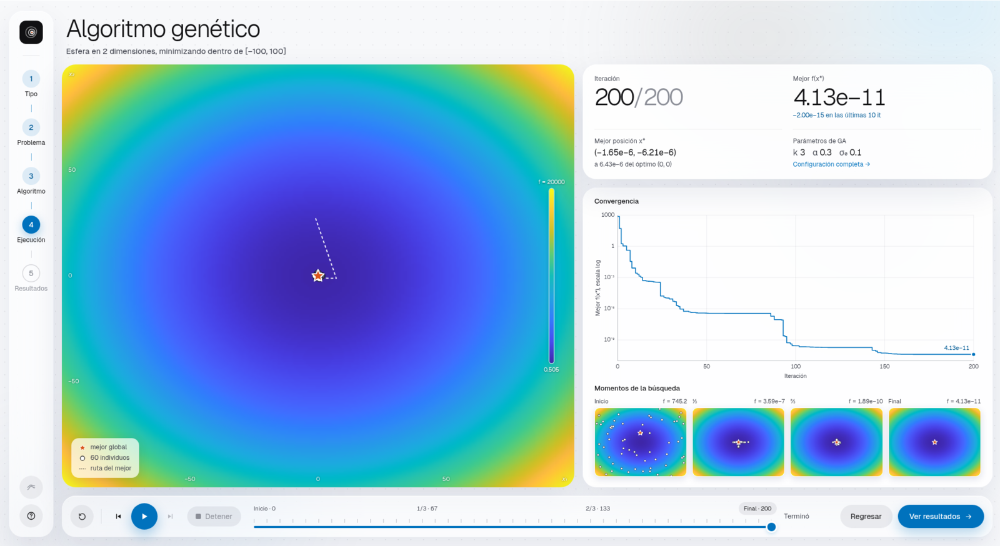
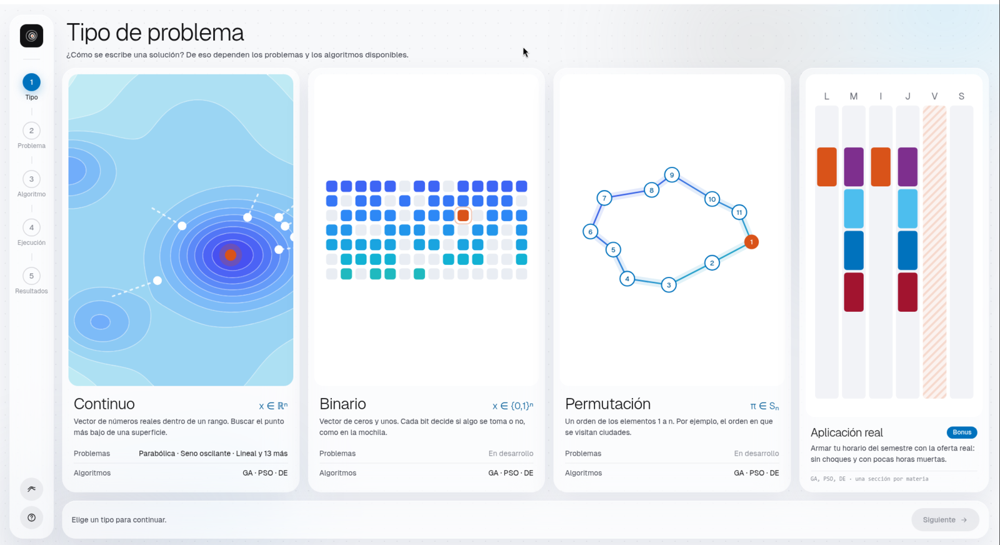
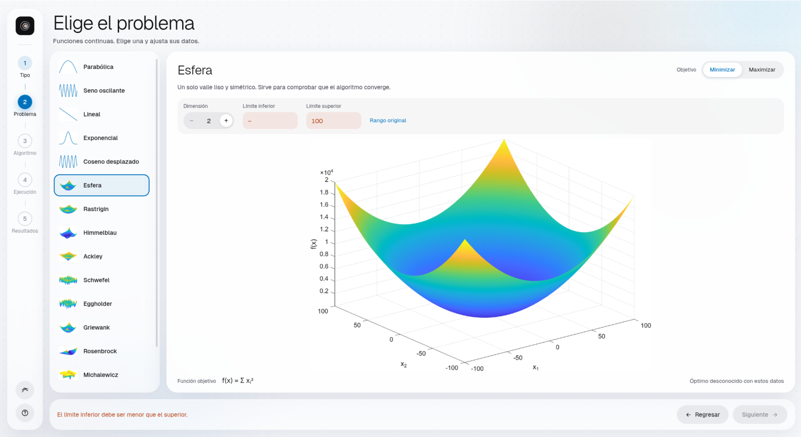
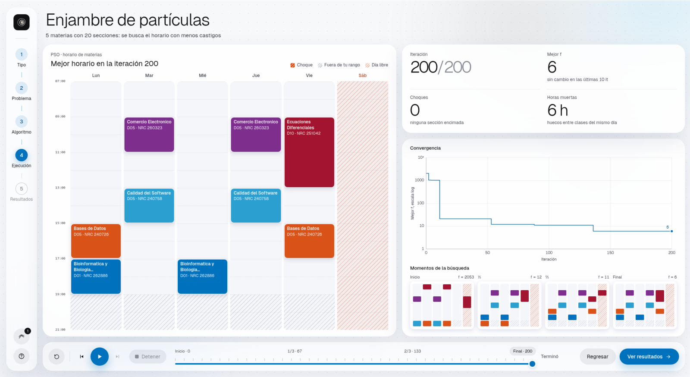

<div align="center">

# Entorno interactivo de metaheurísticas

Configura, ejecuta y compara **GA, ACO, PSO, AIS y DE** sobre problemas continuos, binarios y de permutación,
y mira cómo busca cada algoritmo iteración por iteración.

[](https://www.mathworks.com/products/matlab.html)
[](src/ui/LEEME.md)
[](src/algoritmos)
[](#)



</div>

## Qué hace

- **Cinco pasos guiados**: tipo de problema, problema y datos, algoritmo y parámetros, ejecución y resultados.
- **Ejecución que se puede reproducir**: play, pausa, paso a paso y línea de tiempo con los momentos inicio, ⅓, ⅔ y final.
- **Gráficas reales de MATLAB**: superficies `surf` y mapas con `parula`, más convergencia en escala logarítmica.
- **Validación en vivo**: cada parámetro muestra su rango y no se puede ejecutar con datos inválidos.
- **Comparar ejecuciones** del mismo problema y exportar resultados a CSV o JSON.
- **Semilla fija** en toda ejecución, para que los resultados se puedan repetir.
- **Problema real**: arma tu horario del semestre con la oferta pública de SIIAU, sin choques y con pocas horas muertas.

## Capturas

<table>
  <tr>
    <td width="50%"></td>
    <td width="50%"></td>
  </tr>
  <tr>
    <td align="center"><sub><b>Tipo de problema.</b> Cómo se escribe una solución decide qué algoritmos aplican.</sub></td>
    <td align="center"><sub><b>Problema y datos.</b> Superficie de la función, dimensión, límites y validación.</sub></td>
  </tr>
  <tr>
    <td colspan="2"></td>
  </tr>
  <tr>
    <td colspan="2" align="center"><sub><b>Aplicación real.</b></sub></td>
  </tr>
</table>

## Problemas y algoritmos

| Representación | Problemas | Algoritmos |
|---|---|---|
| Continuo, x ∈ ℝⁿ | Esfera, Rastrigin, Rosenbrock, Ackley, Griewank, Schwefel, Himmelblau, Michalewicz y más | GA, PSO, DE, AIS |
| Binario, x ∈ {0,1}ⁿ | OneMax, mochila | GA, PSO, DE, ACO, AIS |
| Permutación, π ∈ Sₙ | TSP | GA, PSO, DE, ACO, AIS |
| Aplicación real | Horario del semestre (UDG) | GA, PSO, DE |


## Cómo funciona

La interfaz son páginas HTML/CSS/JS dentro de `uihtml`, y MATLAB hace todo el cálculo.
JavaScript solo dibuja: cuando una pantalla carga avisa a MATLAB, MATLAB corre el algoritmo
y le manda el historial completo, y la pantalla lo reproduce. Los detalles están en
[`src/ui/LEEME.md`](src/ui/LEEME.md).

```
 HTML / JS  ──  "lista", "siguiente", "elegir" ...  ──►  MATLAB
 (dibuja)   ◄──      datos, historial, imágenes      ──  (calcula)
```

## Requisitos
- MATLAB **R2023a o más reciente** (usamos R2026a). Solo se necesita MATLAB base.
- (Opcional) VS Code con la extensión **MATLAB** de MathWorks (`.vscode/extensions.json`).

## Cómo correrlo
Abrir MATLAB en la carpeta `Proyecto/` y escribir en la ventana de comandos:

```matlab
MetaheuristicasApp                              % la aplicación completa
run('experimentos/pso_parametros/main_pso.m')   % experimento PSO (tabla + gráficas en resultados/)
run('extras/bha/main_bha.m')                    % demo BHA en Rastrigin 2D (ver extras/)
```
Cada script agrega `src/` al path por su cuenta.

## Estructura

```
Proyecto/
├─ src/
│  ├─ algoritmos/
│  │  ├─ pso/
│  │  ├─ ga/
│  │  ├─ aco/           
│  │  ├─ ais/               
│  │  ├─ de/
│  │  └─ comunes/
│  ├─ problemas/
│  │  ├─ comun/
│  │  ├─ continuo/
│  │  ├─ binario/ 
│  │  ├─ permutacion/ 
│  │  └─ real/ 
│  ├─ core/utilidades/
│  ├─ graficas/
│  └─ ui/   
│     ├─ pantallas/  
│     ├─ demos/
│     └─ web/
├─ experimentos/
│  └─ pso_parametros/
├─ extras/bha/
├─ datos/    
├─ docs/
└─ tests/ 
```

Proyecto final de **Algoritmos Metaheurísticos**, Universidad de Guadalajara